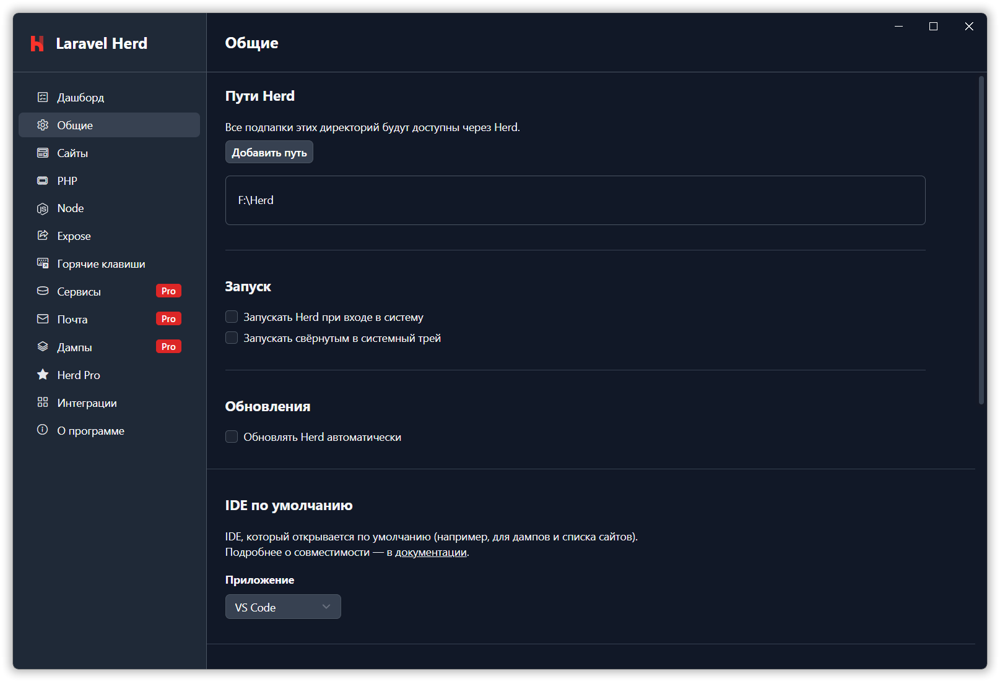

# Herd RU — русская локализация Laravel Herd (Windows)

Неофициальный перевод интерфейса [Laravel Herd](https://herd.laravel.com) на русский язык.
Патчер заменяет строки по словарю `dict/ru.json` и пересобирает `app.asar`.
Перевод охватывает окна, кнопки, подсказки, заголовки и меню трея; часть диалогов
и уведомлений переводится через Electron API.

<p align="center">
  
</p>

## Требования

- Windows и Laravel Herd в `C:\Program Files\Herd` (проверено на 1.30.0).
- Node.js **22.12+** (проверено на 24.x).

## Установка и обновление

Перед первым патчированием [создайте резервную копию](#резервная-копия-и-откат).
Затем выполните в папке проекта:

```powershell
npm install
npm run patch
```

`npm run patch` выполняет `extract → apply → pack → install → launch`:
собирает перевод, закрывает Herd, устанавливает архив и запускает приложение.
Если прав недостаточно, установка запросит подтверждение UAC.

После обновления Herd перевод пропадает. Сохраните оригинальный архив новой
версии в бэкап и повторите `npm run patch`. Незнакомые словарю строки останутся
английскими — найти их помогут [инструменты анализа](#инструменты-анализа-и-проверок).

## Команды

| Команда | npm-скрипт | Действие |
|---|---|---|
| `node patch.js status` | `npm run status` | Версия, состояние установки и SHA256 |
| `node patch.js extract` | `npm run extract` | Пересоздать `work\app` из установленного архива |
| `node patch.js apply` | `npm run apply` | Применить словарь и проверить синтаксис изменённых чанков |
| `node patch.js pack` | `npm run pack` | Пересоздать сборку в `build\` |
| `node patch.js install` | `npm run install-patch` | Закрыть Herd и установить сборку |
| `node patch.js restore` | `npm run restore` | Закрыть Herd и вернуть архив из бэкапа |
| `node patch.js launch` | `npm run launch` | Запустить Herd |

`install` и `restore` при необходимости запрашивают UAC и подтверждают результат
сверкой SHA256. npm-скрипт установки называется `install-patch`, чтобы обычный
`npm install` только устанавливал зависимости.

Пути внутри скриптов определяются относительно проекта: его можно переносить.
Вызовы `node patch.js …` и `npm run …` выше рассчитаны на запуск из папки проекта.

## Резервная копия и откат

Патчер **не создаёт бэкап автоматически**. До замены оригинального архива
сохраните его как `backup\app.asar.orig` и запишите SHA256 в `backup\INFO.txt`.
Пример для PowerShell (прежний бэкап, если он есть, сначала сохраните отдельно):

```powershell
New-Item -ItemType Directory -Force backup | Out-Null
Copy-Item 'C:\Program Files\Herd\resources\app.asar' 'backup\app.asar.orig'
Get-FileHash 'C:\Program Files\Herd\resources\app.asar', 'backup\app.asar.orig'
Get-FileHash 'backup\app.asar.orig' | Out-File 'backup\INFO.txt'
```

Хэши источника и копии должны совпадать. Для отката выполните `node patch.js restore`,
затем `node patch.js launch`. Восстановление возвращает **версию из бэкапа**;
после обновления Herd нужен оригинальный архив новой версии.

Патч не меняет исполняемые файлы Herd, PHP/NGINX, сайты, настройки и hosts.
Шим перевода пишет журнал в `%APPDATA%\Herd\ru-shim.log`.

## Структура проекта

| Путь | Назначение |
|---|---|
| `patch.js` | Патчер и все его команды |
| `biome.json` | Настройки линтера и форматировщика JavaScript |
| `.gitattributes` | Окончания строк LF для JS-файлов и конфигурации Biome |
| `dict\ru.json` | Словарь интерфейса, заголовков и главного процесса |
| `patches\` | Инструменты анализа, отчёты и эталон `unpacked-files.txt` |
| `tests\` | Автоматические тесты перевода, шима и локальной сборки |
| `.github\workflows\tests.yml` | Запуск тестов для pull request в GitHub Actions |
| `backup\` | Оригинальный архив и его SHA256 |
| `work\app\` | Локальная распаковка для применения перевода |
| `build\` | Собранные `app.asar` и `app.asar.unpacked` |

`backup\`, `work\`, `build\` и генерируемые отчёты исключены через `.gitignore`:
их изменения не попадут в коммит.

## Как изменить перевод

Основные записи находятся в `translations` словаря `dict\ru.json`:

```json
{
  "Add Site": "Добавить сайт",
  "Failed": { "ru": "Сбой", "files": ["settings-*"] },
  "General": { "ru": "Общие", "skipBefore": "openSettings(" },
  "Next": { "ru": "Далее", "paddedOnly": true }
}
```

- Строковое значение применяется во всех JS-чанках; `files` ограничивает замену шаблонами имён файлов.
- `skipBefore` защищает литералы после указанного кода, например `openSettings("General")`.
- `paddedOnly` заменяет только текст с крайними пробелами: `" Next "`, но не `"Next"`.
- Совпадение точное; крайние пробелы сохраняются. Статические части template-литералов тоже переводятся.

Другие секции словаря:

| Секция | Назначение |
|---|---|
| `htmlTitles` | Замена `<title>` в HTML окон |
| `mainProcess` | `exact` — точные строки; `rules` — правила с `match` (регэксп) и `replace` |
| `valueFixes` | Исправления уже переведённого текста: `{ "from": "старый перевод", "to": "новый перевод" }` |

Для `mainProcess` команда `apply` добавляет `out\main\ru-shim.js` и словарь
`ru-main-dict.json`: они переводят меню, диалоги, уведомления и заголовки через
Electron API до загрузки V8-байткода. Сам байткод не меняется; строки вне
перехваченных API могут оставаться английскими.

Не добавляйте общие замены для ключей логики (`Mail`, `Dumps`, `Query`, `Favorites`,
значений enum/case), иконок-лигатур (`Next`, `Previous`), CSS-классов и SVG-путей.
Проверяйте контекст и при необходимости используйте ограничения выше.
Имена продуктов, фреймворков и команды сохраняются; `Ungrouped` используется
как идентификатор и обычной заменой строк не переводится.

После правки словаря выполните `apply → pack`; для установки результата —
`install → launch`. Локальная сборка и анализ не управляют установленным Herd.

## Инструменты анализа и проверок

Работают с `work\app` и `build\app.asar`. Сначала подготовьте локальную распаковку
командой `node patch.js extract`. Справка и алиасы: `--help` у двух CLI ниже.

`node patches\analyze-strings.js <режим>` создаёт отчёты в `patches\`:

| Режим | Результат |
|---|---|
| `candidates` (по умолчанию) | Английские UI-кандидаты: `candidates.json`, `candidates.txt`; заголовки: `html-titles.txt` |
| `filter` | Читает `candidates.json`, оставляет кандидаты из чанков приложения в `ui-candidates.txt` |
| `fresh` | Кандидаты, отсутствующие в словаре, включая template-сегменты: `fresh-strings.txt` |
| `remaining` | Более широкий поиск оставшихся кандидатов без CSS, URL и путей: `all-remaining.txt` |
| `all` | Все режимы по порядку: `candidates → filter → fresh → remaining` |

`filter` требует результата `candidates`, но может работать без распаковки.
Отчёты содержат строки, число вхождений и файлы; кандидаты требуют проверки контекста.

`node patches\inspect-strings.js <режим>` выводит контекст в консоль:

| Режим | Что проверяет |
|---|---|
| `search "фраза" [фильтр]` | Префикс литерала; фильтр — часть имени файла с учётом регистра |
| `find` | Набор известных английских строк |
| `fragments` | Заголовки, `Logs` и контекст `Next`/`Previous` |
| `contexts` | Рискованные слова, UI-поля и текст HTML |
| `check-fragments` | Template-фрагменты Log Viewer, Mails и Settings |
| `check-final` | Кнопки и подсказки Settings, menubar и Site Wizard |
| `all` | Все проверки, кроме `search` |

Проверки находят чанки независимо от hash в имени; отсутствие обязательного
чанка завершает их с ненулевым кодом.

| Дополнительная команда | Результат |
|---|---|
| `node patches\scan-bytecode.js` | Строки из `work\app\out\main\index.jsc` → `patches\main-menu-strings.txt`; контекст в консоли |
| `node patches\verify-shim.js` | Проверка шима и словаря в сборке; пересоздаёт `build\verify2` для извлечения архива |

При `apply` изменённые JS-чанки проходят разбор Acorn; при ошибке замена не записывается.
Отчёт `patches\apply-report.json` содержит замены и `unusedKeys`, а новые английские
строки ищутся через `fresh`/`remaining`. Неиспользованные ключи оценивайте на свежей
распаковке: после повторного `apply` уже заменённые оригиналы не находятся.

При `pack` файлы `resources/{bin,config,valet}/**` и `resources/*.png` сохраняются
в `app.asar.unpacked`, как в оригинале. Для проверенной версии ожидается 180 файлов;
при отклонении патчер предупреждает. Эталон — `patches\unpacked-files.txt`.

## Автоматические тесты

После установки зависимостей выполните:

```powershell
npm test
```

Тесты используют встроенный `node:test`, отдельный тестовый фреймворк не нужен.
Они работают на искусственных JS/HTML-файлах и ресурсах во временных каталогах,
которые удаляются после проверки. Установленный Herd, `work\app`, `build\` и
словарь проекта не изменяются; распаковка Herd для запуска тестов не требуется.

Проверяются:

- точные замены, сохранение пробелов и ограничения `files`, `skipBefore`, `paddedOnly`;
- статические части template-литералов и сохранение выражений интерполяции;
- применение перевода, HTML-заголовков и `valueFixes`, отчёт и сохранение исходного
  JS-файла при ошибке синтаксиса;
- повторная установка шима, перевод меню, диалогов, уведомлений и заголовков окон
  на подставных Electron API;
- сборка ASAR, наличие шима и сохранение unpacked-ресурсов, включая dot-файлы;
- импорт патчера без выполнения CLI-команд и отказ CLI при неизвестной команде.

Для изоляции тестов `patch.js` экспортирует `buildLookup`, `translateFile`,
`cmdApply` и `cmdPack`. `buildLookup` принимает словарь; `cmdApply` и `cmdPack`
позволяют передать пути к тестовым файлам. При запуске через CLI используются
обычные пути проекта.

Тесты дополняют проверки локальной распаковки и сборки из предыдущего раздела:
отображение перевода в реальном интерфейсе Herd проверяется отдельно.

## Лицензия и статус

Код патчера и словарь — [MIT](LICENSE). Herd — проприетарный продукт Beyond Code:
его бинарники, включая патченный `app.asar`, не распространяются. Нужен легально
установленный Herd. Проект не является официальной локализацией.
